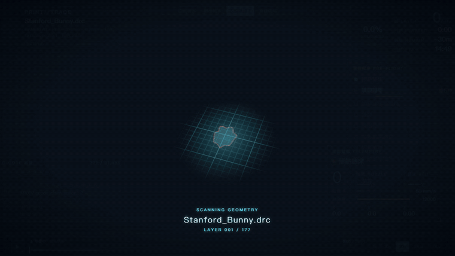
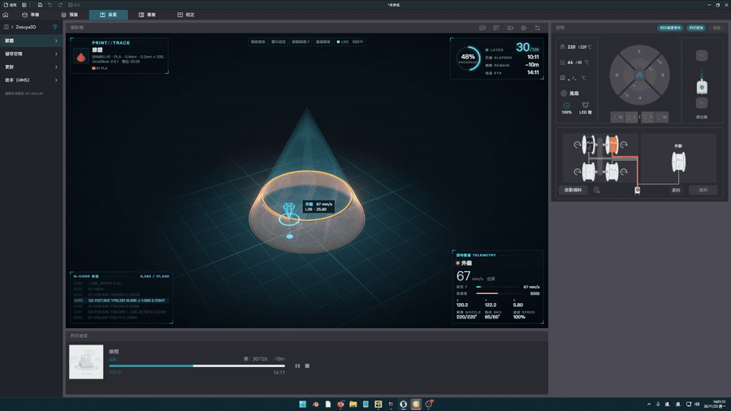
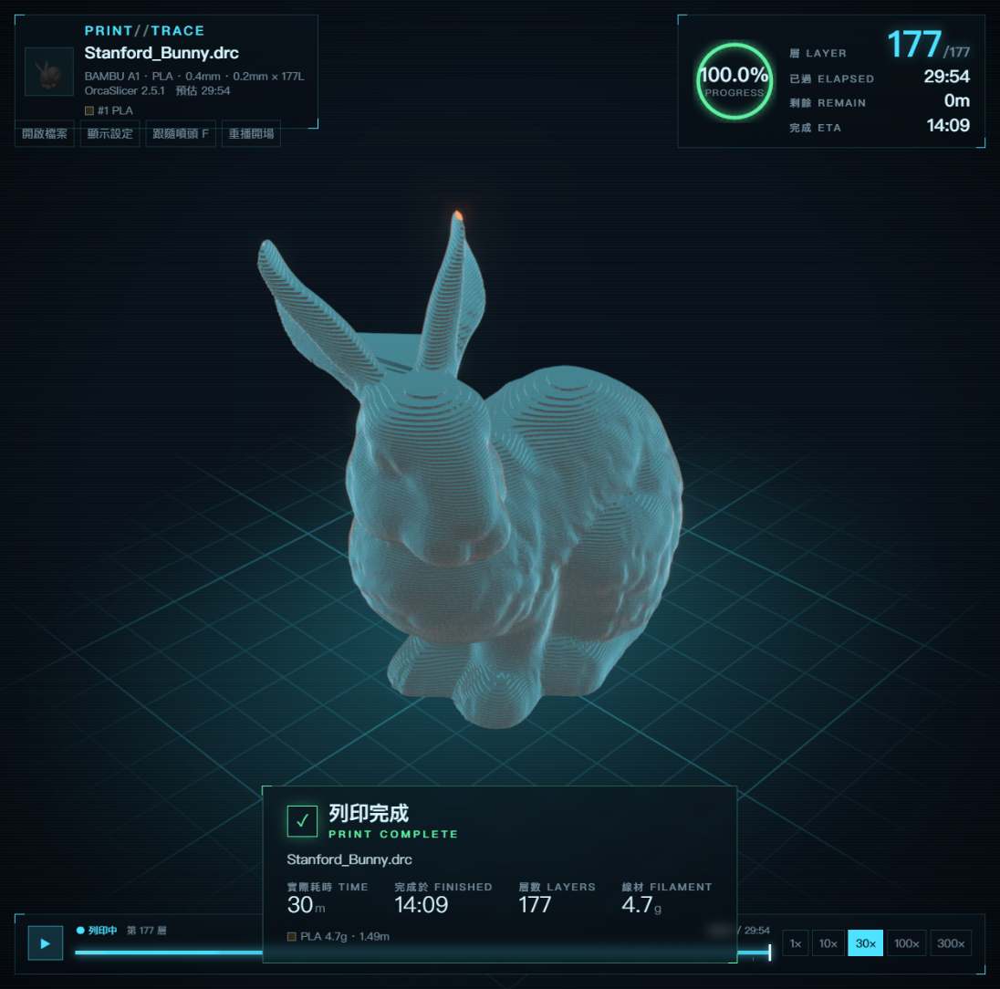
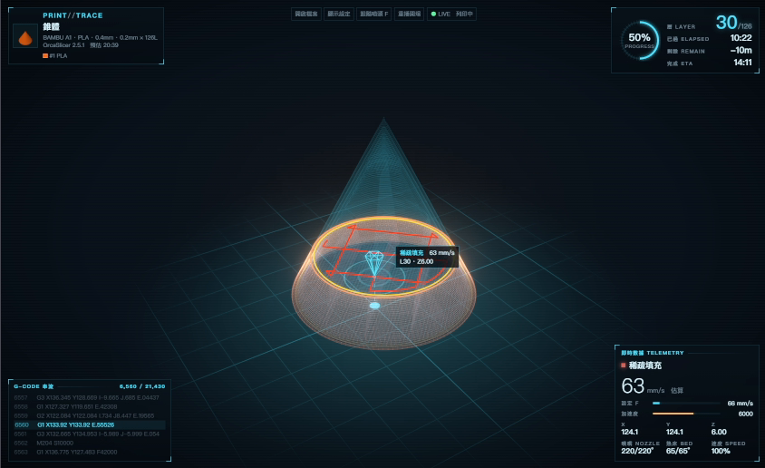

# PRINT//TRACE

**Bambu Lab 列印進度的 3D 即時看板**——讀印表機正在印的 G-code，用科技感的 HUD 把「噴頭現在印到哪」畫出來，可以直接嵌進 OrcaSlicer／Bambu Studio 的「裝置」頁。

*A live 3D HUD for Bambu Lab printers: it reads the G-code being printed and shows where the nozzle is, right inside OrcaSlicer / Bambu Studio. [English below](#english).*



> ⚠️ 這是個人的非官方專案，與 Bambu Lab 無關。只讀取印表機狀態，不會送任何控制指令。

## 看起來長這樣

| 嵌在 OrcaSlicer 裡 | 列印完成 |
|---|---|
|  |  |



## 功能

- **跟著實機跑**：印表機透過區網 MQTT 回報層數、步驟、溫度，後端自動用 FTPS 從 SD 卡下載正在印的檔案，畫面照 G-code 把每一層一條一條畫出來
- **層內位置推算＋自動校正**：A1 不回報正在跑第幾行，所以換層時對齊、層內照 G-code 估時往前推；每次換層比較預估與實際，自動調整推算速度。畫面一直往前跑、不停不跳，落後的量平均攤到下一層補回來
- **準備階段**：照印表機回報的步驟顯示做到哪一步（會跳過的步驟標「略過」），3D 等開始印第一層才跟著跑
- **讀懂 Bambu 的條件區塊**：縮時攝影、擠出校準、調平這些 `M1002 judge_flag` ＋ `M622/M623` 包起來的段落，照印表機設定決定算不算進去
- **畫面**：線框／全息／實體／點雲四種顯示，線條類型或模型顏色（多色自動用模型顏色）；開場動畫、噴頭跟隨模式（F 鍵）、列印完成畫面
- **跟著切片軟體開關**：背景待命，OrcaSlicer／Bambu Studio 開著才連印表機，關掉就停

## 需要什麼

- Bambu Lab 印表機（實測：**A1**；P1、X1、A1 mini 應該可用但未測）
- 印表機和電腦在同一個區網，印表機插著 SD 卡
- [Node.js](https://nodejs.org/) 18 以上
- 印表機的 **IP**、**序號**、**LAN 存取碼**（印表機螢幕「設定 → 網路」或 LAN 模式頁面可以看到）
- 新韌體如果連不上，試著打開「LAN 模式」或「開發者模式」

## 安裝

```sh
git clone https://github.com/Zosuya/print-trace.git
cd print-trace
npm install
```

在專案資料夾建立 `config.local.json`（已經在 `.gitignore`，不會被提交）：

```json
{
  "ip": "192.168.1.50",
  "serial": "你的印表機序號",
  "accessCode": "LAN 存取碼",
  "port": 8765
}
```

> 已經用 OrcaSlicer 連過這台印表機的話，`%APPDATA%\OrcaSlicer\OrcaSlicer.conf` 的 `local_machines` 裡就有這三個值。

## 執行

```sh
node server.mjs                  # 直接啟動，打開 http://localhost:8765/
node server.mjs --with-slicer    # 背景待命：切片軟體開著才啟動，關掉就停
```

**Windows 開機自動待命**（隱藏執行、不會有黑色視窗）：

```powershell
pwsh tools/autostart.ps1 install     # 安裝並立刻在背景啟動
pwsh tools/autostart.ps1 status
pwsh tools/autostart.ps1 uninstall
```

紀錄寫在 `cache/server.log`。

### 嵌進 OrcaSlicer／Bambu Studio

「裝置」頁 → 攝影機區右上角的設定 → 自訂攝影機來源，網址填：

```
http://localhost:8765/
```

之後改版時，頁面會自己重新整理。

### 用手機、平板看

`config.local.json` 加上 `"host": "0.0.0.0"`，再用 `http://<電腦的 IP>:8765/` 開。預設只聽本機。

### 沒有印表機也能玩

- 把任何切好片的 `.gcode.3mf`／`.gcode` 拖進網頁（或用中間的「選擇檔案」），可以播放、拖時間軸（離線模式）
- 模擬列印：`node server.mjs --sim 檔案.gcode.3mf 100`（每秒跑 100 行，假裝是印表機在回報）

## 操作

| | |
|---|---|
| F | 噴頭跟隨模式 |
| ↑ ↓ | 換層（即時模式會暫停跟隨，按「回到即時」回來） |
| ← → | 前後 5 秒（Shift：1 分鐘，離線模式） |
| 空白鍵 | 播放／暫停（離線模式） |
| S | 顯示設定（顯示方式、上色方式、空跑路徑等） |

## 怎麼運作

```
印表機 ──MQTT(8883, TLS)──▶ server.mjs ──SSE──▶ 網頁（three.js）
       ──FTPS(990)────────▶  下載正在印的 .gcode.3mf
```

- 印表機本身就是 MQTT 伺服器，帳號 `bblp`、密碼是 LAN 存取碼，訂閱 `device/<序號>/report`
- 用到的欄位：`gcode_state`、`stg_cur`、`layer_num`、`mc_percent`、`mc_remaining_time`、`spd_mag`、溫度、`ipcam.timelapse`
- 準備階段每一步的實際時間會記在 `cache/prep-log.jsonl`，下次用來判斷會不會調平、擠出校準

## 已知限制

- A1 的 `mc_print_line_number` 一直是 0，層內位置只能推算（實測在 `M73 L` 插標記也沒用，層數是韌體自己算的）
- 雙噴頭（H2D）的切換還沒處理
- 一次只接一台印表機
- 實體外殼用外牆中心線擠出，比實際模型小約半個線寬

## 工具

- `tools/probe.mjs`：MQTT 連線測試，印出狀態欄位
- `tools/record.mjs`：錄下列印過程中每筆回報的變化
- `tools/prep-compare.mjs`：比對準備階段的預估與實際時間
- `tools/check-page.mjs`：檢查網頁主程式語法

## 授權

MIT。使用的第三方程式：[three.js](https://threejs.org/)（MIT），放在 `lib/`。

---

## English

**PRINT//TRACE** is an unofficial live 3D dashboard for Bambu Lab printers. A small Node.js server listens to the printer's local MQTT broker (`mqtts://<ip>:8883`, user `bblp`, password = LAN access code), downloads the job's `.gcode.3mf` over FTPS, and streams status to a three.js page via SSE. The page replays the G-code toolpath in sync with the printer:

- layer changes from the printer anchor the playback; inside a layer the position is estimated from G-code timing and auto-calibrated against real layer durations, so the animation never stalls or jumps
- prep stages follow the printer's `stg_cur`; conditional blocks (`M1002 judge_flag` + `M622/M623`, e.g. timelapse) are evaluated like the firmware does
- wireframe / hologram / solid / point-cloud renderers, intro animation, nozzle-follow camera, print-complete screen
- `--with-slicer` mode starts/stops together with OrcaSlicer / Bambu Studio; embed it via the Device tab's custom camera URL `http://localhost:8765/`

Setup: `npm install`, create `config.local.json` with `ip`, `serial`, `accessCode`, then `node server.mjs`. Tested on an A1; other Bambu models should work but are untested. Read-only — no commands are sent to the printer. Not affiliated with Bambu Lab. MIT licensed.
